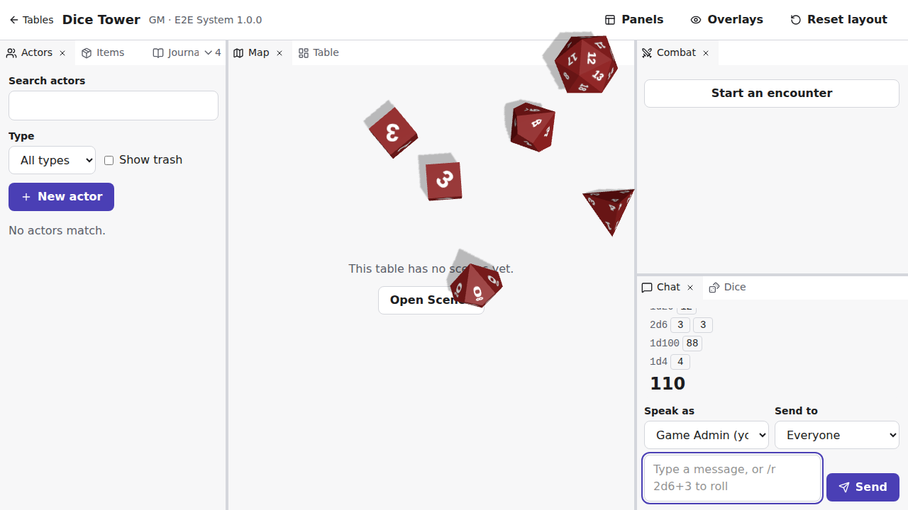

# Study: 3D dice as a module (T-1604)

- **Date:** 2026-11-09
- **Plugin:** [`plugins/dice-3d`](../../plugins/dice-3d), version 1.0.0
- **Question:** can an author build 3D dice that land on the server's results using only what the plugin format and the module SDK (ADR-075, ADR-077) offer? What is missing, and what was awkward?

_`/r 1d20 + 2d6 + 1d100 + 1d4`, after the dice landed: d20 on 12, both d6 on 3, the d100 as 80 and 8, the d4 on 4. The chat showed the result as soon as the server rolled it. A player at the same table, in a window of the same size, saw the same throw._

## What was built

`dice-3d` is a module with one overlay, `dice`, and five `user` settings: dice colour, number colour, size, whose rolls to throw (every roll I see, or mine only) and how long the dice stay after landing.

1. The overlay listens with `useTableEvents`. Each `chat.message` with rolls becomes one throw: a die for each result of a d4, d6, d8, d10, d12 or d20, and two d10 (tens and units) for a d100, up to 30 dice. Dropped and rerolled dice land too, dimmed.
2. The throw is simulated in full with cannon-es before anything is shown, at 60 steps a second until every die sleeps (6 s at most), and each step is recorded.
3. For each die, the face (or for a d4 the vertex) that ended up on top is read, and the die's labels are swapped so that face shows the server's result. The physics decides how the dice tumble, never what they show.
4. three.js plays the recording back on a transparent canvas over the page, with shadows on an invisible floor the size of the window. After the chosen number of seconds the dice fade out. With `prefers-reduced-motion`, they appear already landed.
5. The random generator is seeded from the message id, so viewers with windows of the same size see the same throw.

The code is about 950 lines across `code/src/` (shapes, physics, scene, overlay) and is unit tested (shapes are flat and outward, labels and d100 split, the physics comes to rest with a face up). The e2e test (`e2e/tests/dice-3d.spec.ts`) installs the code's dependencies, packs the plugin with the CLI, installs and enables it, rolls from the chat as the GM, checks that the chat shows the roll while the dice still roll, that both the GM's and a player's overlays land on the server's results and fade, and that a player's **Overlays** switch removes the overlay for them only.

## What worked well

- **Events are the right ones.** A roll arrives once, already decided and filtered for the viewer, with each die's value and whether it counts. A GM-only roll never reached a player's overlay. Nothing in the module can change a result.
- **WebGL works in the sandboxed frame**, in headless Chromium in CI too. `prefers-reduced-motion` reaches the frame.
- **`vtt-plugin pack` bundled three.js and cannon-es** without any configuration once they could be resolved (see F1).
- **`user` settings fit dice well:** each member picks their colours once, for every table that uses the module, under **My settings**.
- **The Overlays switch** gives each member a way out of a module they dislike, with no work for the author.

## Findings

Each finding says what was missing or awkward, what the module did about it, and how it was checked.

### F1. Plugins cannot declare npm dependencies

The format and the guide say nothing about dependencies. `pack` resolves imports from `node_modules` next to the code, so a dependency must be installed beside the plugin, but a `package.json` at the plugin's root is reported as `unknown_file` and packed into the archive. **Workaround:** a `package.json` in `code/`, which `pack` skips with every other `.json` under `code/`, installed on its own with `pnpm install --ignore-workspace --lockfile=false` (ADR-078). Authors outside this repository have to find this out on their own. The guide's advice to keep plugins in `plugins/` "to get type checking" does not hold either: nothing type-checks `tiny-d20`'s code, and `dice-3d`'s is checked only by hand, through its own `tsconfig.json`.

### F2. `pack` ships whatever else is under `code/`

`pack` leaves out script and JSON files under `code/` but keeps everything else. The first archive held the package's HTML coverage report (10 files, 165 KB). There is no ignore list. A `pnpm-lock.yaml` in `code/` would ship too, and pnpm 12 ignored `lockfile=false` in a `code/.npmrc`. **Workaround:** the package writes no coverage, and is installed with `--lockfile=false`, its dependencies pinned to exact versions.

### F3. Code size and delivery

`code/client.js` is 627 KB minified (157 KB gzipped), almost all three.js. The server sends it uncompressed with `cache-control: no-cache`, so each table load revalidates it. The page loads it into a probe frame to list its overlays and panels, then again into each overlay frame, each time as a `data:` URL built from the whole text. One overlay copes; several large modules on a table would be felt on slow devices. Not measured further.

### F4. No WebAssembly in frames

The frame's policy has no `'wasm-unsafe-eval'`. In the app, `WebAssembly.compile` in an overlay frame fails with a CSP error (checked with a probe in Chromium). The maintained physics engines for the web (Rapier, Jolt, Ammo) are WebAssembly, so the module uses cannon-es, which is plain JavaScript but has had no release since 2022. The page itself already allows `'wasm-unsafe-eval'` for QuickJS (ADR-074).

### F5. Workers: `data:` works, `blob:` does not

The same probe found that a worker from a `blob:` URL fails while one from a `data:` URL runs, since the frame's `script-src` allows `data:`. The physics could move off the frame's main thread that way, but nothing documents workers, and it may be an accident of the policy rather than a feature. The module does not use workers, and it shows: on a desktop (Node, same code), a throw of 4 dice simulates in 3–13 ms, but one of 30 dice takes about 200 ms and still has dice rocking at the 6-second cap, so a large roll stalls the overlay for a dozen frames before the dice appear. Phones were not measured.

### F6. No sound

Dice that clatter need audio. The frame's policy refuses `data:` audio (checked: `NotSupportedError`), and frames load nothing from the server, the plugin's own files included. An `AudioContext` did start in headless Chromium, whose autoplay rules are loose; in browsers with default autoplay rules a click-through overlay never receives the user gesture that unlocks audio, and the frame has no `allow="autoplay"`. Not verified in a regular browser. The module has no sound.

### F7. Results show before the dice land

ADR-077 says the chat never waits for a frame, and it does not: the chat shows the total while the dice are in the air (the e2e checks this). That is the requirement, but it removes the suspense 3D dice are for. A module cannot ask the chat to hold a result for a moment, even for the viewer alone.

### F8. Custom dice cannot be drawn

A frame gets each die's name (`d6`, `dF`…) and, for custom dice, the face's `label`, but not the system's `dice.json`: it cannot know how many faces a custom die has or what the others show. The module skips custom dice. Standard dice it has no shape for (d2, d3, d7…) are skipped too; the chat still shows them.

### F9. Everyone's dice use the viewer's colours

Dice colour is a `user` setting, and a frame only gets the viewer's own values, so another player's roll is thrown in the viewer's colours. Neither the message nor its speaker carries a colour. Per-player dice, a staple of 3D dice tools, are not possible.

### F10. Settings inputs

There is no colour setting: colours are `string` settings shown as text fields, and the code falls back to the default when a value is not `#rrggbb`, silently. Enum options turned out to pass through the module's translations, so values written as lang keys (`size.small`) show translated labels; the reference only says a `select` "offers these values".

### F11. The overlay does not know the page's layout

An overlay covers the whole page and learns nothing of where the map, the chat or the header are, so dice roll over all of them (see the picture). It cannot keep dice on the map or off the chat. An `interactive` overlay takes every click on the page, so clicking a die to dismiss it would block the page.

### F12. The event shapes are not in the reference

The guide says `chat.message` comes "with its `rolls` with dice and totals". Writing the module needed the exact shape (`dice[].die`, `results[].value`, `active`, `label`), which is only in `packages/shared/src/api/rolls.ts`. There is also no documented way to test a module component outside the app: `ModuleFrameContext` is exported, but nothing says how to provide it. For the e2e, the overlay exposes its state as `data-state` and `data-results` attributes.

## Proposed follow-up tasks

None of these is planned yet. The tasks the user approves join M16; the decisions go to §14 as questions first.

| #   | Proposal                                                                                                                                                                                                                                                    | Findings |
| --- | ----------------------------------------------------------------------------------------------------------------------------------------------------------------------------------------------------------------------------------------------------------- | -------- |
| P1  | **Plugin dependencies and pack hygiene.** Document `code/package.json` for dependencies (and type checking) in the guide; make `pack` ship only the plugin's files (no stray reports or notes under `code/`), and stop warning about a root `package.json`. | F1, F2   |
| P2  | **Module event reference and test helper.** Generate the reference for table events, chat messages and rolls from the shared schemas, and document a helper to render a module component with a fake frame in unit tests.                                   | F12      |
| P3  | **System dice for modules.** Give frames the table system's custom dice (faces and labels), so modules can draw them.                                                                                                                                       | F8       |
| P4  | **Shared user settings.** Let a `user` setting be marked shared, so frames get other members' values by user id (each player's dice colour).                                                                                                                | F9       |
| P5  | **Colour settings.** A `colour` format for `string` settings, checked by the validator and the server and shown as a colour input; document that enum options can be lang keys.                                                                             | F10      |
| P6  | **Overlay layout.** Tell overlays where the named parts (map, chat, header) are on screen, and when that changes, so a module can keep its drawing to one of them.                                                                                          | F11      |
| P7  | **Plugin code delivery.** Serve plugin code compressed and cacheable under a versioned URL, and load it once per page rather than once for the probe and once per frame.                                                                                    | F3       |
| P8  | **Check `dice-3d` in CI.** Add its type check and unit tests to the pipeline (the e2e test installs its dependencies and packs it, but nothing else in CI does).                                                                                            | F1       |

Decisions to take before any task:

- **D1.** Allow `'wasm-unsafe-eval'` in plugin frames, as on the page, so modules can use WebAssembly engines? (F4)
- **D2.** Allow workers in frames on purpose (and document them), or close `data:` workers? (F5)
- **D3.** Allow sound from modules: audio from the plugin's files or `data:` URLs, and the frame permission to play it after the viewer's first click on the page? (F6)
- **D4.** Let each viewer choose to see a roll's result in the chat only once their dice module says the dice landed, within a short limit? This changes ADR-077's "the chat never waits"; the server and other viewers would be unaffected. (F7)
